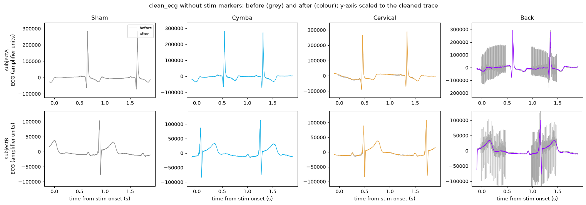

# stim-artifact-removal

Remove periodic electrical-stimulation artifact (cutaneous stimulation, TENS) from ECG recordings,
so R-peak detection, HRV and waveform measures can be trusted on data
recorded during stimulation. Stim markers are optional: the artifact's
timing is found from the signal itself.



Example recordings, cleaned without stim markers. Grey:
before. Color: after. Two subjects recorded at 5 kHz and 25 kHz.

## Install

```bash
git clone https://github.com/ausbollinger13/ecg-stim-artifact-removal.git
cd ecg-stim-artifact-removal
pip install -e .            # core
pip install -e ".[all]"     # + XDF, MATLAB v7.3 and Excel readers
```

Requires Python ≥ 3.9, NumPy, SciPy, pandas, NeuroKit2 and matplotlib.

## Use

**Command line.** Point it at a file, several files or a folder:

```bash
stim-artifact-removal --input examples/data/subjectA_back.mat
stim-artifact-removal --input recordings/ --recursive --non-interactive
```

Each input gets a cleaned signal (CSV, XLSX, MAT or JSON), a diagnostics
JSON, an HRV before/after summary and a before/after figure. Supported
inputs: CSV/TXT/TSV, Excel, JSON, MATLAB (incl. v7.3) and XDF. The time
axis, sampling rate and ECG channel are detected automatically, and the
choice is printed.

**Python.**

```python
from stim_artifact_removal import clean_ecg, ecg_hrv, load_ecg_file

rec = load_ecg_file("examples/data/subjectA_back.mat", interactive=False)
out = clean_ecg(rec["sig"], rec["ts"], rec["fs"])          # no markers needed
# out = clean_ecg(raw, ts, fs, stim_times=onsets)          # if you have them

cleaned, fs = out["ecg"], out["fs"]                        # 1 kHz by default
print(out["mode"], out["diagnostics"]["window_ms"])
print(ecg_hrv(out["ecg_preprocessed"], fs)["RMSSD"], "->", ecg_hrv(cleaned, fs)["RMSSD"])
```

Pass the raw recording at its original sampling rate. Cleaning works best
at high rates (≥ 2 kHz), and `clean_ecg` decimates only after cleaning.

See [docs/usage.md](docs/usage.md) for all options, input-format rules and
outputs.

## How it works

1. **Find the artifact's timing.** Stimulation spikes have far higher
   sample-to-sample curvature than any part of a heartbeat. The latency at
   which such events recur is calibrated from the stim markers. Without
   markers, the stimulation period and phase are recovered from the events
   themselves. If nothing periodic is found, the recording is returned
   unchanged.
2. **Despike.** Inside that window, samples whose curvature exceeds a
   threshold set relative to the recording's own QRS curvature are
   interpolated over.
3. **Subtract the stim-locked template.** Smooth after-effects (amplifier
   recovery, spike tails) are estimated as the per-offset median across all
   stimulation cycles and subtracted. Heartbeats are not locked to the
   stimulation, so they do not enter the template.
4. **Filter and decimate.** The mains notch and baseline high-pass are
   applied after cleaning, then the signal is decimated (anti-aliased) to
   the output rate.

Details and design rationale: [docs/method.md](docs/method.md).

## Validation

The method was validated on six subjects with dedicated recordings: Sham,
auricular (cymba conchae), cervical and back stimulation, at 5 kHz and
25 kHz, 25-100 Hz pulse trains. It was also checked on a 28-subject,
336-recording study.

- Sham recordings: none were altered.
- Stimulation-locked residual after cleaning: at the random-time null on
  31 of 36 active recordings (marker and marker-free runs combined); the
  rest are reduced from 10-17× to 1.3-1.6×.
- QRS amplitude: unchanged inside stimulation trains (0.98-1.03× the
  amplitude outside).
- HRV: matched an independent reference pipeline (r = 0.995-0.997).

Full results: [docs/validation.md](docs/validation.md). Reproduce the
example results with `python examples/validate_examples.py`.

## Tests

```bash
pip install -e ".[dev]"
pytest
```

## License

MIT. See [LICENSE](LICENSE).
